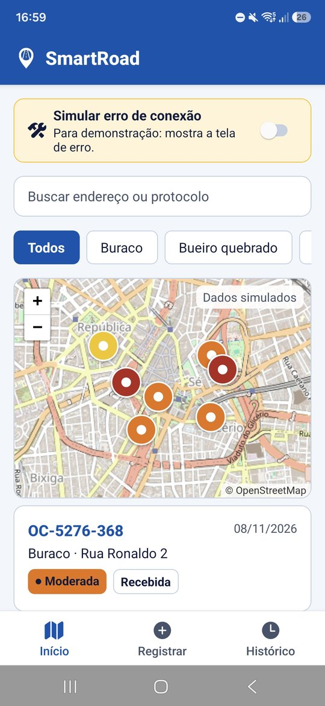
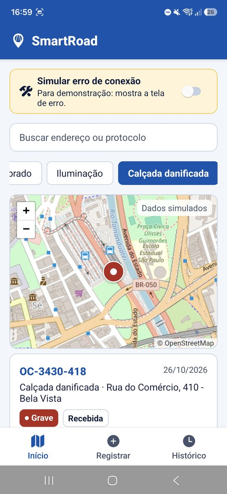
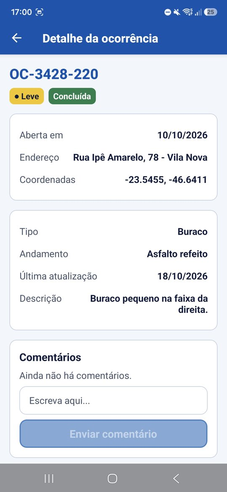

# CitizenTech — SmartRoad

<p align="center">
  
</p>

## Integrantes

| Nome | RM |
| --- | --- |
| Gustavo Viega Lopes Martins | RM555885 |
| Gustavo Yuji Osugi | RM555034 |
| Kaio Drago Lima Souza | RM556095 |
| Otávio Santos de Lima Ferrão | RM556452 |
| Vitor Rivas Cardoso | RM556404 |

## Sobre o projeto

**SmartRoad** é um app mobile para o cidadão **registrar e acompanhar problemas na rua**: buracos, bueiros quebrados, falta de iluminação e calçadas danificadas. Feito com React Native (Expo + TypeScript + Expo Router) na **Global Solution 2026.2 — Mobile Development & IoT**.

- **Ver** as ocorrências da cidade num mapa real (OpenStreetMap) e numa lista, com busca e filtro por tipo.
- **Registrar** um problema em menos de 1 minuto: tipo, gravidade, localização do celular e foto (opcionais) e descrição.
- **Acompanhar** o andamento de cada ocorrência (Recebida → Em andamento → Concluída) e **comentar**.
- **Funcionar offline**: sem internet, o app avisa, usa uma cópia local das ocorrências e troca o mapa real por um mapa ilustrativo.
- **Acessível**: contraste alto, áreas de toque de 48 px e rótulos para leitor de tela.

## Prints das telas

<table>
  <tr>
    <td align="center"></td>
    <td align="center"></td>
    <td align="center"></td>
    <td align="center"></td>
  </tr>
  <tr>
    <td align="center"><b>Início</b><br/>Mapa com um pino por ocorrência, busca e lista</td>
    <td align="center"><b>Filtro por tipo</b><br/>Mapa e lista mostram só o tipo escolhido</td>
    <td align="center"><b>Registrar</b><br/>Tipo, gravidade, local, foto e descrição</td>
    <td align="center"><b>Detalhe</b><br/>Dados, andamento e comentários</td>
  </tr>
</table>

**Como ler as cores:** os pinos e as etiquetas de gravidade usam amarelo para **Leve**, laranja para **Moderada** e vermelho para **Grave**. A etiqueta "Dados simulados" no mapa lembra que as ocorrências da cidade são fictícias. A tela **Histórico** lista só o que o próprio usuário registrou.

## Ficha da CitizenTech

> **Rascunho para conferir com a equipe.** Os campos seguem o modelo sugerido no briefing da GS. Os itens marcados com _(confirmar)_ são sugestões e precisam da decisão do grupo.

| Campo | Descrição |
| --- | --- |
| **Nome da CitizenTech** | SmartRoad |
| **Cidade e bairro** | São Paulo (SP). Os dados de exemplo ficam no Centro e arredores. _(confirmar)_ |
| **Cidadão beneficiado** | Moradores da cidade que andam, dirigem ou pedalam pelas ruas, inclusive pessoas com baixa visão e usuários de leitor de tela. |
| **Problema, em uma frase** | Buracos, bueiros quebrados e outros problemas da rua demoram a ser resolvidos, e o morador não tem um jeito simples de avisar nem de saber em que pé está o reparo. |
| **Como funciona** | O cidadão vê as ocorrências num mapa e numa lista, registra um problema em menos de 1 minuto (com localização do celular e foto, se quiser) e acompanha o andamento e os comentários. |
| **O que cada parte faz** | **App mobile (este repositório):** interface do cidadão para consultar, registrar e acompanhar ocorrências. **Demais disciplinas:** _(preencher com as outras partes da solução)_ |
| **Link do repositório** | https://github.com/MAJE-Dev/CitizenTech |
| **Indicador de impacto** | Tempo médio entre o registro e a conclusão do reparo, e número de ocorrências resolvidas por bairro. _(confirmar)_ |
| **ODS conectados** | ODS 11 (Cidades e comunidades sustentáveis) e ODS 9 (Indústria, inovação e infraestrutura). _(confirmar)_ |

**Jornada principal:** Início (ver ocorrências) → Registrar (avisar um problema) → Histórico (ver o que registrei) → Detalhe (andamento e comentários).

## Como rodar o app

Precisa de Node 20 ou mais novo e do app **Expo Go** no celular (ou um emulador Android/iOS).

```bash
cd app
npm install
npx expo start
```

Leia o QR code com o Expo Go. No emulador, aperte `a` (Android) ou `i` (iOS).

Com internet, o app busca as ocorrências de exemplo e mostra o mapa real. Sem internet ele continua funcionando: avisa o usuário, usa a cópia das ocorrências que vai dentro do app e troca o mapa real por um mapa ilustrativo.

Também há um APK pronto na aba **Releases** do repositório.

## Telas (Expo Router)

| Tela | Arquivo | O que faz |
| --- | --- | --- |
| Início | `app/src/app/(tabs)/index.tsx` | Mapa real com um pino por ocorrência, busca, filtro por tipo e lista |
| Registrar | `app/src/app/(tabs)/nova.tsx` | Formulário com localização do celular e foto (opcionais), salvo no banco |
| Histórico | `app/src/app/(tabs)/historico.tsx` | Ocorrências que o usuário registrou |
| Detalhe | `app/src/app/ocorrencia/[id].tsx` | Dados, foto, andamento e comentários |

## Tecnologias

| Para quê | Tecnologia |
| --- | --- |
| App e navegação | React Native 0.88, Expo 58 e Expo Router (abas + tela de detalhe) |
| Linguagem | TypeScript |
| Banco local | `expo-sqlite` |
| Mapa | Leaflet dentro de `react-native-webview`, com imagens do OpenStreetMap |
| Localização | `expo-location` |
| Foto (câmera e galeria) | `expo-image-picker` e `expo-image` |
| Build do APK | GitHub Actions (workflow **Build APK**) |

## Identidade visual

O logo é um **pino de mapa com uma rua dentro**: o lugar do problema e a via que ele afeta. Ele aparece no ícone do app, na tela de abertura e na barra do topo.

| Cor | Hex | Onde aparece |
| --- | --- | --- |
| Azul SmartRoad | `#0054b0` | Barra do topo, botões, links, aba ativa, ícone e tela de abertura |
| Azul escuro | `#003d82` | Botão pressionado |
| Azul claro | `#e6f0fb` | Fundos suaves de destaque |
| Amarelo sinalização | `#ffc21a` | Faixa da rua no logo e borda dos avisos |

O topo e os botões usam **o mesmo azul**. A paleta fica em `Marca`, dentro de `app/src/theme.ts`, e os arquivos do logo em `app/assets/brand/` (SVG) e `app/assets/images/` (PNG).

## Banco de dados: SQLite (`expo-sqlite`)

Escolhemos o **SQLite local** porque é gratuito, funciona sem internet depois de instalado, não pede conta nem chave e roda no Expo Go. Qualquer pessoa executa o app com um comando. As tabelas são `ocorrencias` (o que o cidadão registra, com a foto e a localização) e `comentarios`, e todo o acesso passa por `app/src/services/db.ts`. Fechar e abrir o app mantém os dados.

- **Protocolo único:** o protocolo é a chave primária da tabela. Antes de gravar, o app confere o protocolo sorteado contra a lista da cidade e contra o banco; se já existir, sorteia outro (`registrarOcorrencia` em `app/src/services/ocorrencias.ts`).
- **Atualização sem perder dados:** a versão do esquema fica no próprio banco (`PRAGMA user_version`). Quem já tinha a versão anterior instalada mantém as ocorrências e os comentários.

## De onde vêm os dados

- **Ocorrências da cidade:** mock em `app/mock/ocorrencias.json`, com endereços, datas e coordenadas **fictícios**. O app busca esse arquivo com `fetch` (`app/src/services/api.ts`) na URL raw do GitHub e trata **carregando**, **erro** (com botão "Tentar de novo") e **lista vazia**. A lista fica na memória enquanto o app está aberto: abrir o Detalhe ou voltar para o Início não baixa tudo de novo (puxar a lista para baixo atualiza).
- **Ocorrências do usuário, comentários e fotos:** salvos no aparelho (SQLite e pasta do app). A foto e a localização **não são enviadas para nenhum servidor**.
- **Localização:** só é lida quando o usuário toca em "Usar minha localização" (`app/src/services/localizacao.ts`). Se ele negar a permissão, basta digitar o endereço.
- **Mapa:** imagens do [OpenStreetMap](https://www.openstreetmap.org/copyright), gratuito e sem chave, mostradas com Leaflet dentro de um WebView (`app/src/components/MapaReal.tsx`).
- Não há dados pessoais reais em nenhum ponto.

### Como ver o estado de erro

Na tela **Início**, logo no topo, ligue a chave **"Simular erro de conexão"**. O app mostra a mensagem de erro com o botão "Tentar de novo".

## Configuração (`.env`, opcional)

O app **não usa chaves, senhas nem serviços em nuvem**, então não precisa de `.env` para rodar. Só se quiser apontar para outro JSON de exemplo ou outro servidor de mapa:

```bash
cd app
cp .env.example .env
# edite EXPO_PUBLIC_API_URL e/ou EXPO_PUBLIC_MAPA_TILES
```

O `.env` está no `.gitignore` e nunca vai para o repositório.

## Estrutura

```
app/
  mock/            JSON com as ocorrências de exemplo
  src/app/         telas e navegação (Expo Router)
  assets/          ícone, tela de abertura e logo (fontes em assets/brand)
  src/components/  componentes reutilizáveis (botões, cartões, mapas)
  src/services/    api.ts (fetch), ocorrencias.ts (dados), db.ts (SQLite),
                   localizacao.ts (GPS) e fotos.ts (câmera e galeria)
  src/hooks/       useCarregar (loading, erro e recarregar)
  src/theme.ts     paleta da marca, cores, fontes, espaçamentos e tamanhos (tema centralizado)
```

## Acessibilidade

- Fontes de 14 a 24 e contraste acima de 7:1 no texto principal e no texto branco sobre o azul da marca.
- Áreas de toque de pelo menos 48 px.
- `accessibilityLabel` e `accessibilityRole` em botões, abas, campos e pontos do mapa.
- Erros anunciados por leitor de tela e linguagem simples.
- O mapa nunca é o único caminho: a lista logo abaixo traz as mesmas ocorrências.
- Localização e foto são opcionais; quando a permissão é negada, o app explica o que fazer.

## Vídeo (até 3 minutos)

> **PREENCHER:** link do YouTube (não listado) mostrando o app rodando, a jornada completa e os dados sendo salvos e recuperados.

## Gerar uma nova versão do APK

1. Confira a versão em `app/app.json` (`version` e `android.versionCode`) e em `app/package.json`.
2. No GitHub, abra **Releases → Draft a new release**, crie a próxima tag da sequência (ex.: `v6`) apontando para a `main` e publique.
3. O workflow **Build APK** (`.github/workflows/build-apk.yml`) compila o app e anexa o `SmartRoad-CitizenTech.apk` na release. Acompanhe o andamento na aba **Actions**.

Para só testar se compila, sem publicar: **Actions → Build APK → Run workflow**, escolha o branch e deixe o campo da tag vazio. O APK fica como _artifact_ da execução.

## Observação

A pasta `src/` na raiz é um protótipo web feito no Lovable. A entrega da GS é o app em `app/`.
